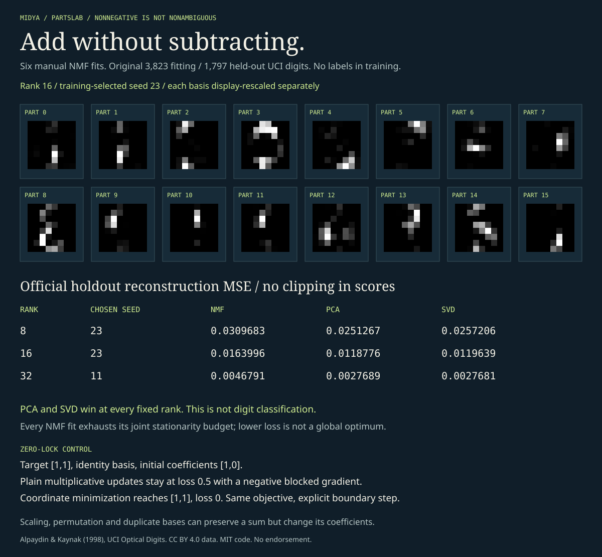

# PartsLab

**Add without subtracting.**

Manual NumPy nonnegative matrix factorization on the original licensed UCI digits. Six complete fits, numerical KKT stopping, fixed-basis NNLS inference, rank-matched signed controls, and an editable browser decomposition. No scikit-learn, model APIs or training labels.



## Run it

```bash
python -m pip install -e .
python -m partslab demo
python -m unittest discover -s tests -v
node --test tests/*.cjs  # Node 22+ and Chrome; CHROME_BIN overrides the executable
python -m partslab train --out /tmp/models.json --guard /tmp/guard.json
python -m partslab evaluate --models /tmp/models.json --guard /tmp/guard.json --out /tmp/report.json
python examples/export_browser.py
python examples/render_audit.py
```

Try the [live parts inspector](https://midya8.github.io/partslab/), or open `docs/index.html` locally. The browser solves new nonnegative coefficients for arbitrary edited 8x8 pixels. It shows every part's actual contribution, a rescaled basis view, coefficient weights, unclipped reconstruction errors, signed PCA/SVD/mean controls, every fit's descent and exact JSON copy/download. No server, uploads, analytics or remote calls. Twenty original official test rows are included by index, not selected for success. The package has seven CLI subcommands: `demo`, `train`, `evaluate`, `predict`, `audit`, `certify`, `verify-certificate`.

## v0.2: an exact bound for the fixed-basis solve

A stopping residual is not an objective-gap bound. The browser now constructs and checks a separate exact primal/dual witness over the actual supplied binary64 pixels, basis and coefficients. It displays an outward-rounded interval for the fixed-basis optimum and a bound on candidate suboptimality, including at zero inference sweeps. Portable JSON proofs can be pasted into the browser checker or checked by an independent Python `Fraction` verifier. A residual-shift witness can be loose. This is not joint NMF optimality, unique coefficients, semantic identification or source authentication.

[Certificate proof, arithmetic, controls, CLI usage and limits](CERTIFICATE.md). All original fits, holdout scores, selection protocol and frozen guards are unchanged. The 120 exact reference witnesses cover the twenty already-public examples for six models, not all holdout rows.

## Constraints have a cost

Every arm uses all 3,823 original training images, ranks 8/16/32, seeds 11/23, and 100 outer iterations with three coefficient/basis sweeps each. Within each rank, minimum **training-only reencoded MSE** selects a seed. All six runs remain public. There is no holdout-based rank or iteration choice.

| Fixed rank | Training-chosen seed | NMF test MSE | Centered PCA | Uncentered SVD |
|---:|---:|---:|---:|---:|
| 8 | 23 | 0.0309683 | 0.0251267 | 0.0257206 |
| 16 | 23 | 0.0163996 | 0.0118776 | 0.0119639 |
| 32 | 11 | 0.0046791 | 0.0027689 | 0.0027681 |

All 1,797 official test rows. Training-mean baseline MSE: 0.0735163. Scores use raw, **unclipped** reconstructions. Images alone clip to [0,1]. The signed controls win at every fixed rank, and remain visible. PCA stores a mean as well as its rank-k components, so rank matching is not exact parameter matching. This is a fixed-data reconstruction audit, not perceptual quality, recognition accuracy, causal interpretability or broad model superiority.

## Descent is not convergence

- Each scalar coordinate update minimizes a bounded quadratic. Explicit gradients, projected-gradient residuals and every outer loss are saved. No epsilon is silently added to zero denominators; zero basis rows are handled as flat directions.
- **All six joint NMF fits exhaust the stated budget without meeting their joint stationarity tolerance.** The browser says so. Monotone loss does not prove stationarity, a local minimum or a global optimum. Numeric residuals are not exact certificates.
- Held-out fixed-basis NNLS is a convex subproblem. All 1,797 rows meet the numerical per-row KKT criterion in every saved arm. It is a relative residual threshold, not a certified objective-gap or unique-coefficient guarantee. Arbitrary future inputs may exhaust the inference budget, which is reported as unfinished.
- Plain multiplicative updates can lock a zero even when its gradient is negative. The identity-basis control stays at loss 0.5 while coordinate minimization reaches zero. This does not describe every modified multiplicative-update method.
- Scaling/permuting factors can leave the sum unchanged. Duplicate basis vectors give different coefficients for the same reconstruction, even with a fixed dictionary. A unit-norm display convention does not establish semantic or unique parts.

[Method, equations, protocol, independent references and sources](METHOD.md).

## Verification

38 Python tests and eleven Node/real-Chrome tests. Independent active-set NNLS enumeration on 35 tiny random problems, finite-difference gradients, scalar coordinate/objective references, zero/duplicate/budget cases, full six-fit reproduction forbidding test access, frozen hashes before evaluation, all-row holdout/control reproduction, and exact SVG regeneration. Exact certificates add 80 independent rational active-set optima, a sum-of-squares gap identity, subnormal/rounding/tamper controls and 120 cross-language exact witness reproductions. Browser checks compare 120 native/scalar-JavaScript decompositions, 2,048 actual contribution pixels, arbitrary edits, keyboard controls, zero-sweep unfinished bounds, valid/tampered pasted proofs, copy failure/success, download, and expanded 320/390/1280 layouts. Installed-wheel checks import ten modules and execute all ten CLIs outside the checkout, including full training and holdout reproduction.

Original data: Alpaydin & Kaynak (1998), [UCI Optical Recognition of Handwritten Digits](https://archive.ics.uci.edu/dataset/80/optical+recognition+of+handwritten+digits), CC BY 4.0. Original source hashes and license are in `partslab/data/`. Derived bases and summaries are new transformations. Code MIT. Established algorithms, original implementation; no endorsement.


## v0.3: exact fixed-face pixel response

[Open the fixed-face inspector](docs/face.html) · [Math, controls and reproduction](FACE.md)

Nominate an NNLS face from a frozen numeric solution, then re-solve and check it exactly for the supplied binary64 basis and pixels. One pixel varies along a bounded line. Every affine coefficient/inactive-gradient inequality defines its maximal candidate-validity interval, with all endpoint ties and singleton cases explicit. BigInt construction and verification run in a Worker; source selection, invalid-query retention, exact endpoint queries and downloadable witnesses stay inspectable.

The native Fraction and scalar browser implementations match 54 complete source responses across all six frozen bases, with independent determinant/Cramer tiny-system oracles, all120 source nominations, actual Chrome Workers and pixel checks. Original fits, data, score tables, certificates and stronger signed PCA/SVD controls are unchanged. This is not a full solution path, unchanged strict support, uniqueness, robustness, semantics or joint-NMF optimality. Singular selected blocks refuse construction; verification checks supplied affine candidates without solving.
